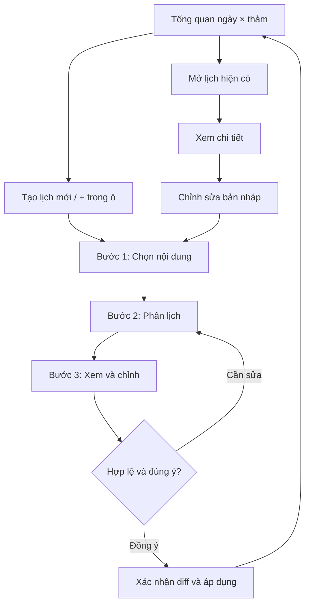

# SportData — Đặc tả “Sắp xếp trận đấu” · v3 yêu cầu triển khai

Ngày chốt yêu cầu: 11/10/2026. Nguồn: sportdata-master(1).zip, archive comment c9ad5486f2bd8050b273e19b1100ff8fce897d07.

Tài liệu này là yêu cầu sản phẩm và kỹ thuật đã tổng hợp để giao Codex triển khai. v3 thay thế luồng UI trong v1/v2: màn hình đầu tiên bắt buộc là tổng quan ngày × thảm; tạo/chỉnh lịch dùng 3 bước. Không lấy mockup v2 nhiều điều khiển cùng màn hình làm flow chuẩn.

Nguồn đối chiếu: source và ảnh QA inline-schedule.png trong ZIP. Chưa sửa application, chạy database hay thay đổi production. Trang trực tiếp chưa được xác minh sau đăng nhập. Khi triển khai trên branch mới hơn, đọc lại code thực tế; đường dẫn/symbol trong mục 2 là điểm bắt đầu, không phải lý do ghi đè thay đổi mới.

Cách dùng: đưa nguyên file này vào context của Codex, yêu cầu thực hiện mục 10. Các API/model ở mục 7 là thiết kế đề xuất, được điều chỉnh theo convention repo nếu vẫn đáp ứng toàn bộ invariant và acceptance. Các số liệu demo không phải dữ liệu hoặc luật của giải thật.

### Phạm vi giao hàng

- Tổng quan ngày × thảm, tạo nhiều lịch độc lập; một ô có thể chứa nhiều lịch không trùng giờ.
- Wizard 3 bước; lưu nháp, mở lại, áp dụng nguyên tử, sửa lịch hiện hành có diff.
- Nhiều nội dung/nhóm hạng; thứ tự nội dung → vòng chuẩn hóa → cân nặng → ordinal trận.
- Một lịch qua nhiều ngày; dời cả vòng, dời phần đuôi từ một trận, tự tiếp tục khi hết giờ.
- Xung đột thảm/VĐV/đội xuyên mọi lịch, rule thời gian nghỉ, khóa lịch, cạnh tranh nhiều người sửa.
- Tích hợp API lịch/bảng điểm/public hiện hữu; không làm mất sơ đồ cây hoặc kết quả.
- Không gồm: tự tạo pairing/bốc thăm từ người chưa đăng ký, tự thay luật giải, tự cập nhật kết quả trận, tự publish/deploy production, tự điều phối song song một chuỗi trên nhiều thảm cùng thời điểm.

Các bước MAIN_TREE → nhánh phụ là mốc triển khai kỹ thuật, không phải quyền tự bỏ yêu cầu. Đánh giá và báo rõ khả năng hỗ trợ của cả GI, No-GI, Fighting, Duo, Show dựa trên dữ liệu thật; chỉ hỗ trợ MAIN_TREE thì chưa được báo toàn tính năng hoàn tất.

## 1. Quyết định sản phẩm

Thay nhãn “Danh sách” bằng “Sắp xếp trận đấu” trong tab Trận đấu. Giữ “Sơ đồ cây”. Màn hình mới làm việc ở cấp sự kiện và mở bằng tổng quan ngày × thảm. Người dùng chọn một ô hoặc “Tạo lịch mới”, rồi chọn ngày/thảm bắt đầu và nhiều nội dung thi đấu. Bộ lọc một category hiện tại chỉ giữ trong chế độ Sơ đồ cây.

Đơn vị lập lịch: một kế hoạch (chuỗi thi đấu) của sự kiện, trải trên nhiều cửa sổ ngày/giờ/thảm được người dùng cho phép. Một hạng, một vòng và một khối nội dung đều có thể tiếp tục qua ngày khác. Ngày/thảm trên màn hình là cửa sổ xem/chỉnh, không phải kế hoạch độc lập. Trong chuỗi có các khối nội dung được xếp theo ordinal; mỗi khối có nhiều hạng đấu. Mỗi vòng gồm các hạng cân tăng dần; mỗi hạng/vòng gồm các trận được phép đổi thứ tự. Một trận không bị chia nhỏ qua hai ngày.

Thứ tự ưu tiên bắt buộc:

1. Tập cửa sổ ngày/giờ/thảm được phép dùng là ràng buộc thời gian; không reset thứ tự khi qua ngày mới.
2. Nội dung theo thứ tự người dùng chọn (GI, No-GI, Duo… là các nội dung; khác với loại sơ đồ MAIN_TREE/REPECHAGE).
3. Giai đoạn/vòng chuẩn hóa, ngoài → trong.
4. Hạng cân thấp → cao trong vòng hiện tại.
5. Thứ tự trận tùy chỉnh trong cùng hạng + cùng vòng + cùng nhánh.

Giả định diễn giải yêu cầu: áp dụng **rào chắn vòng giữa tất cả hạng được chọn trong cùng khối nội dung**. Tất cả trận vòng 32 người phải được xếp trước bất kỳ trận vòng 16 người nào, rồi tứ kết, bán kết, chung kết. Sau chung kết và mọi nhánh phụ được chọn của No-GI mới bắt đầu Duo. Phạm vi “No-GI trước Duo” là cùng chuỗi kế hoạch, xuyên suốt mọi ngày/thảm của chuỗi đó. Nếu No-GI còn trận sang ngày mai, Duo đứng sau cũng phải chờ. Các chuỗi độc lập trên thảm khác không tự bị áp rule này; nếu chuyển chuỗi sang thảm khác, thứ tự của chuỗi vẫn giữ nguyên.

“Hạng cân thấp → cao” áp dụng lại ở từng vòng. Không thể vừa hoàn tất cả giải của hạng nhẹ trước hạng nặng, vừa xen kẽ các hạng theo vòng. Thiết kế chọn cách xen kẽ theo vòng, phù hợp mô tả vòng ngoài → trong.

“Kết thúc vòng trước” trong lập lịch là thời điểm dự kiến kết thúc, KHÔNG yêu cầu có kết quả thật mới cho lập lịch vòng sau. Vòng chưa biết VĐV vẫn có suất lịch, hiển thị “Thắng trận #…”; nút bắt đầu thi đấu tiếp tục kiểm tra điều kiện vận hành.

### Chuẩn hóa thuật ngữ vòng

- 1/32 = vòng 64 người (tối đa 32 trận).
- 1/16 = vòng 32 người (tối đa 16 trận).
- 1/8 = vòng 16 người (tối đa 8 trận).
- Tứ kết = vòng 8 người; bán kết = vòng 4 người; chung kết = vòng 2 người.

Ví dụ 32 VĐV loại trực tiếp thường bắt đầu ở vòng 32 người (1/16), không phải 1/32. UI nên ghi “Vòng 32 người · 1/16” để tránh nhầm. Với nhánh 18 VĐV trong khung 32, có 2 trận thực ở vòng 32 và 14 lượt BYE nếu phân bổ BYE chuẩn. Luôn đọc sơ đồ đã sinh làm nguồn sự thật; số VĐV chỉ dùng ước tính trước khi sinh sơ đồ.

## 2. Những gì đã có trong source

Tất cả đường dẫn dưới đây tương đối với root repository.

| File / symbol | Hiện trạng đã đọc | Hệ quả triển khai |
|---|---|---|
| apps/frontend/src/components/cms/EventWorkspace.tsx — MatchesTab | Chọn một category, Segmented tree/list, bảng 50 trận/trang, SWR refresh 5 giây, sửa sân inline | Tách MatchSchedulingWorkspace; không xếp trên 50 dòng hiện tại; giữ riêng categoryId của Sơ đồ cây |
| apps/frontend/src/components/cms/InlineMatchSchedule.tsx | Sửa ngày/giờ một trận bằng PATCH /matches/:id, giờ Việt Nam, giữ duration nếu đã có | Không dùng luồng PATCH từng dòng để lưu một batch; bổ sung drawer sửa + xem ảnh hưởng |
| apps/backend/prisma/schema.prisma — Category | discipline, uniform, gender, beltLevel, tuổi, minWeight/maxWeight, format, matchDurationSeconds | Group nội dung theo metadata; weight theo số, không parse tên; tuổi/giới/đai không trộn nhầm |
| schema.prisma — Match | matchNumber, round, bracketPosition, winnerToMatchId, loserToMatchId, fopId, matchDate, startTime/endTime, sessionId/timeSlotId, scheduleLocked | Có nền cho dependency và lịch; chưa có mô hình kế hoạch/ordinal như đề xuất |
| schema.prisma — CompetitionSession/TimeSlot/SportSchedulingRule | Phiên đấu, slot, thời lượng, turnaround, minRest; rule theo event + sport | Tận dụng constraint/rule, thêm override theo khối nội dung; không làm mất cấu hình đang có |
| apps/backend/src/matches/matches.service.ts — buildWinnerBracket | round đánh từ 1 ở vòng ngoài của từng draw | round=1 của hai hạng không nhất thiết cùng giai đoạn |
| matches.service.ts — distributeEventMatchDates/orderMatchesByProgression | Phân ngày tương đối đều theo thứ tự phụ thuộc; không có thứ tự nội dung/hạng cân theo yêu cầu | Không tái dùng nút “Chia đều theo ngày” như thuật toán mới |
| matches.service.ts — findAll/hideByes và hasCompetitionActivity | Có phân biệt BYE tự sinh với hoạt động thi đấu | Trích xuất quy tắc BYE chung; không lọc bằng việc thiếu athlete đơn thuần |
| apps/backend/src/scheduling/scheduling.service.ts — autoSchedule | Có dryRun, slot, rest, predecessor, optimistic updatedAt khi ghi; sort round/categoryId/matchNumber | Tận dụng kiểm tra nhưng cần planner mới: thuật toán cũ chưa có scope ngày/thảm và thứ tự nội dung/cân nặng |
| scheduling/dto/scheduling.dto.ts — AutoScheduleDto | Chỉ dryRun/onlyUnscheduled/sportIds/categoryIds | Cần DTO kế hoạch riêng; không nhồi thứ tự và phiên bản vào endpoint cũ |
| apps/backend/prisma/sql/match-schedule-constraints.sql | CHECK end > start; EXCLUDE trùng thời gian theo fop; TimeSlot cũng có EXCLUDE | Batch đổi chỗ phải tránh va chạm tạm thời trong transaction |
| apps/frontend/src/app/cms/operations/page.tsx | Có màn hình điều hành, khóa lịch và trạng thái kết quả | Đồng bộ API/validator với luồng cũ để không có đường sửa phá thứ tự |

Lưu ý tái sử dụng autoSchedule: onlyUnscheduled hiện dùng startTime=null HOẶC timeSlotId=null. Trận đã được sửa giờ thủ công nhưng chưa có timeSlotId có thể lọt vào tập “chưa xếp”. Planner mới phải xác định assignment rõ ràng, không kế thừa điều kiện này một cách máy móc.

## 3. UI và luồng người dùng bắt buộc

### 3.1. Thuật ngữ hiển thị

| Khái niệm | Nhãn UI | Ý nghĩa |
|---|---|---|
| Schedule plan | Lịch thi đấu, ví dụ “Lịch A · GI” | Một chuỗi có ordinal, có thể kéo dài nhiều ngày |
| Discipline block | Nội dung thi đấu | GI, No-GI, Fighting, Duo, Show theo metadata phù hợp |
| Category | Hạng đấu | Giới tính/tuổi/đai/cân nặng cụ thể |
| Schedule window | Ngày/giờ/thảm được phép thi đấu | Khoảng khả dụng, không tự chiếm độc quyền cả thảm |
| Stage | Vòng đấu | Giai đoạn chuẩn hóa, không phải raw round của từng draw |
| Chain sequence | STT lên thảm | Thứ tự trong chuỗi, độc lập mã trận sơ đồ |

Không đưa tên DB, DAG, transaction, revision hash, adapter vào nhãn thao tác của người tổ chức giải.

### 3.2. Màn hình đầu tiên: Tổng quan lịch toàn giải

Entry point: CMS → Sự kiện → Trận đấu → **Sắp xếp trận đấu**. Giữ nút/chế độ **Sơ đồ cây**. Bộ lọc category của sơ đồ không lọc mất các nội dung trong tổng quan lịch.

- Desktop: bảng ngày × thảm. Hàng là các ngày thuộc event theo timezone, cột là các FOP của event. Danh sách FOP/ngày lấy từ server, không hardcode 3 ngày/3 thảm.
- Mỗi ô liệt kê các đoạn lịch hiện hành theo giờ. Một lịch nhiều ngày xuất hiện ở nhiều ô với cùng planId/tên; đoạn sau có nhãn “Tiếp tục”.
- Mỗi thẻ: tên lịch, tên nội dung (rút gọn kèm xem đủ), giờ bắt đầu–kết thúc của đoạn ngày đó, số trận ĐÃ XẾP, trạng thái, nút “Mở lịch”. Không cộng nhầm tổng toàn chuỗi thành số trận từng ô.
- Ô trống: “Chưa có lịch” và **+ Tạo lịch**. Ô đã có lịch vẫn có **+ Tạo lịch** để tận dụng thời gian trống, không coi cả ngày đã kín.
- Nút toàn trang **Tạo lịch mới** mở wizard chưa chọn ngày/thảm. Nút trong ô điền sẵn ngày/thảm; không ghi DB ngay.
- Khi chọn ô có lịch, gợi ý giờ trống sớm nhất đủ duration nếu biết; nếu không xác định được, để người dùng chọn. Không mặc định ghi đè lịch cũ hoặc lấy cuối ngày bất kể còn chỗ hay không.
- Khu riêng “Bản nháp”: tên, người cập nhật, thời điểm, số lỗi nếu có, nút “Tiếp tục chỉnh”. Bản nháp không phải lịch chính thức, không chiếm thảm. Nháp của lịch đã áp dụng hiện badge “Có thay đổi chưa áp dụng” trên lịch đó; tổng quan mặc định vẫn dùng bản applied.
- Một ngày/thảm có các lịch kế tiếp nhau là hợp lệ; intervals trùng mới là xung đột. Khoảng trống trong khoảng min/max của một lịch không được coi là bị chiếm trọn.
- “Chưa có sân/thảm”: hiện CTA sang tab Sân/FOP. “Chưa có hạng”: CTA tới quản lý hạng; “Chưa có nhánh”: hướng dẫn sinh nhánh, không tự tạo draw khi tạo lịch.
- Mobile: chọn ngày, rồi danh sách thảm và thẻ lịch xếp dọc. Không ép hiển thị bảng rộng nhiều cột bằng chữ quá nhỏ.

Ví dụ tổng quan (minh họa phân công, không phải schedule fixture bắt buộc):

| Ngày | Thảm 1 | Thảm 2 | Thảm 3 |
|---|---|---|---|
| 11/10 | Lịch A · GI | Lịch B · Fighting | + Tạo lịch |
| 12/10 | Lịch A · GI tiếp tục | Lịch C · No-GI → Duo | + Tạo lịch |
| 13/10 | + Tạo lịch | + Tạo lịch | Lịch D · Show |

Luồng điều hướng cần triển khai:



### 3.3. Wizard tạo lịch — Bước 1: Chọn nội dung

Mở trang/panel đủ rộng trong workspace, có tiêu đề “Tạo lịch thi đấu”, nút quay lại Tổng quan và stepper: **1. Nội dung → 2. Phân lịch → 3. Xem & chỉnh**. Không dồn toàn bộ cấu hình cả ba bước trên màn hình đầu.

| Trường | Hành vi |
|---|---|
| Tên lịch | Gợi ý từ nội dung đầu tiên, người dùng sửa được; định danh bằng ID, không dựa vào tên |
| Ngày bắt đầu | Chỉ ngày thuộc event; điền từ ô tổng quan nếu có |
| Thảm bắt đầu | Chỉ FOP thuộc event; điền từ ô tổng quan nếu có |
| Nội dung | Multi-select các nhóm metadata, thêm nhiều trong một lần |
| Thứ tự nội dung | Số 1..N, kéo thả + nút lên/xuống + nhập vị trí; tự chuẩn hóa không trùng ordinal |
| Hạng đấu mỗi nội dung | Checkbox, sắp cân thấp → cao; kèm số entries, đơn vị VĐV/đội, số trận thật và vòng bắt đầu |

- Không cho kéo hạng cân vượt rule thấp → cao. Tuổi/giới/đai khác nhau phải phân nhóm rõ để không trộn.
- Category đã thuộc lịch đang áp dụng khác: hiển thị “Đang ở Lịch B”, link mở lịch; không silently duplicate. Nếu chỉ xuất hiện ngày khác trong cùng plan thì vẫn chọn bình thường.
- Nhiều bản nháp có thể đề xuất cùng category; báo cảnh báo mềm ở draft. Khi apply phải kiểm tra ownership/assignment hiện hành và cạnh tranh một cách nguyên tử.
- Category chưa sinh nhánh: hiển thị lý do chưa xếp được; chỉ đưa các hạng có nhánh hợp lệ vào tập apply. Không ước lượng N-1 thay dữ liệu trận thật rồi ghi lịch.
- Loại nhánh chưa hỗ trợ tự xếp: báo trước khi tiếp tục, không giấu một phần trận hoặc nhánh phụ. Người dùng có thể bỏ chọn hạng đó, nhưng UI không tự bỏ.
- Nút **Tiếp tục** yêu cầu tên hợp lệ, ngày/thảm và ít nhất một hạng đủ điều kiện được chọn; **Lưu nháp** cho phép lưu selection còn thiếu thông tin ở dạng draft schema hợp lệ.

### 3.4. Wizard — Bước 2: Phân lịch

Mặc định chỉ mở cấu hình cơ bản; các mốc theo vòng nằm trong phần “Chủ động chia theo vòng” có thể mở thêm.

1. Ngày đầu: giờ bắt đầu/kết thúc, thảm đã chọn ở bước 1.
2. Nút **Thêm ngày tiếp tục**: mỗi ngày có checkbox bật, ngày, thảm, khung giờ, khoảng nghỉ. Gợi ý ngày hợp lệ tiếp theo và giữ thảm cũ; chỉ dùng sau khi người dùng thêm/bật. Không tự thêm ngày ngoài event.
3. Thời lượng dự kiến mỗi trận, thời gian chuyển trận. Giá trị ban đầu theo rule hiện hữu; hỗ trợ override nội dung. Hiển thị rõ đơn vị phút, không gộp duration và gap thành một trường mơ hồ.
4. Thời gian nghỉ tối thiểu giữa hai trận của VĐV: lấy rule giải hiện hữu và cho chỉnh theo quyền. Không reset mặc định 60 phút trong source về 0 chỉ để giống demo. Demo số học dùng 0 phải được ghi rõ.
5. Toggle **Hết giờ thì tiếp tục ngày hợp lệ kế tiếp**. Chỉ tìm trong các ngày/thảm đã bật. Khi tắt, overflow thành lỗi/chưa xếp, người dùng có thể đặt mốc tiếp tục thủ công.
6. **Chủ động chia theo vòng**: chọn nội dung + semantic stage → “Không bắt đầu trước [ngày] [giờ]”. Đây là mốc sớm nhất; không ép chính xác nếu vòng trước kết thúc muộn. Có thể đặt nhiều mốc, sửa và bỏ từng mốc.
7. Hỗ trợ cả chuyển vòng có chủ ý và overflow trong cùng plan. Không bắt người dùng chọn một trong hai chế độ loại trừ nhau.
8. Nếu đổi ngày/thảm đầu ở bước 1: cập nhật window đầu có cảnh báo tác động; không âm thầm xóa các window/mốc đã nhập.
9. Validate bắt đầu < kết thúc, interval nằm trong event, break nằm trong window, ngày/thảm hợp lệ, các window trong một chuỗi không chồng thời gian. Thảm của lịch khác có thể có cùng window khả dụng nhưng occupied intervals phải được tôn trọng khi xếp.

Nút **Quay lại**, **Lưu nháp**, **Tạo lịch xem trước**. Quay lại giữ toàn bộ state. Bấm xem trước gọi backend planner, không tự ghi Match. Nếu validation thiếu thông tin: báo tại trường, giữ input; không tiến tới màn hình trống.

### 3.5. Wizard — Bước 3: Xem & chỉnh

Chỉ sau khi có proposal mới hiện chi tiết trận. Có thanh tổng hợp: đã xếp/tổng trận thật, số trận chưa xếp, ngày kết thúc, lỗi/cảnh báo. Các tab ngày cho thấy thảm, số trận và khoảng giờ. Đổi tab không thay scope tính toán.

Danh sách nhóm: **Nội dung → Vòng → Hạng cân → Trận**. Mặc định mở nhóm tóm tắt, không bung hàng trăm trận. Header nhóm ghi phần hôm nay/tổng nhóm, ví dụ “-77kg · 12/16 trận hôm nay; 4 trận tiếp tục 12/10”. Không gọi các trận đã xếp là đã đánh.

Dòng trận: STT toàn chuỗi, mã trận sơ đồ bất biến, giờ dự kiến, cặp đấu hoặc nguồn “Thắng trận #…”, trạng thái, hành động. Nút bảng điểm giữ cơ chế kiểm tra quyền và điều kiện thi đấu cũ.

| Hành động | Phạm vi và kết quả |
|---|---|
| Đổi thứ tự trận | Chỉ cùng category/stage/draw; thay ordinal, tính lại phần đuôi, không thay bracketPosition/progression |
| Dời từ đây | Chọn matchId chưa đấu → earliest ngày/giờ; mọi trận phía sau trong chuỗi theo thứ tự mới, không chỉ các dòng đang nhìn |
| Đổi ngày bắt đầu vòng | Đặt/sửa earliest stage trên toàn nhóm hạng của nội dung |
| Sửa giờ/thời lượng/nghỉ | Reflow phần liên quan xuyên ngày, cho xem before/after |
| Thêm nội dung nối tiếp | Quay lại bước 1 trong cùng plan, thêm vào cuối hoặc vị trí được chọn |
| Thêm lịch trên thảm khác | Quay về tổng quan → Tạo lịch mới; không nhập nội dung vào chuỗi hiện tại |
| Cố định giờ | Tạo hard pin riêng; không âm thầm dịch mốc này khi reflow |
| Hoàn tác/Làm lại | Áp dụng cho chỉnh sửa draft; không trực tiếp đổi applied revision |

- Tìm/filter chỉ đổi hiển thị. Khi chỉ thấy một phần nhóm, tắt reorder hoặc mở drawer toàn bộ nhóm trước khi đổi.
- Nhóm có thể trải qua ngày 11/12 nhưng vẫn cùng groupId. Chỉ cho reorder vùng chưa đấu, không vượt trận locked/running/finished theo cách buộc dời các trận đó.
- Mỗi thay đổi làm preview cũ stale. Debounce/recompute ở backend; trong khi tính, hiện loading và khóa Apply. Response request cũ không được ghi đè preview của input mới.
- Cuối ngày có nút **Xem phần tiếp tục** tới ngày/thảm tiếp theo. Đầu ngày tiếp hiện nhóm đang tiếp tục và bao nhiêu trận đã xếp ở ngày trước.
- Xung đột ghi rõ lịch/trận liên quan, thời gian và hành động có thể sửa; không chỉ toast “Có lỗi”.
- Nếu có warning chưa biết VĐV vòng sau: hiển thị rõ giới hạn và yêu cầu acknowledge trước apply khi policy của giải cho phép. Xung đột chắc chắn, vi phạm rule cứng, slot ngoài event luôn chặn apply.
- Nút **Quay lại**, **Lưu nháp**, **Áp dụng lịch**. Save draft không đổi lịch hiện hành. Apply bị disable khi lỗi, stale, đang preview hoặc còn trận dự định xếp chưa được xếp.

### 3.6. Xác nhận áp dụng và kết quả

Khi bấm Apply: hiện diff ngắn gọn toàn chuỗi — thêm mới, đổi giờ, đổi ngày/thảm, giữ nguyên, số trận bị ảnh hưởng, các ngày liên quan. Bản tạo mới ghi rõ tổng số trận/ngày; bản chỉnh sửa có before/after. Xác nhận → một server transaction → thành công đưa về tổng quan, highlight plan vừa cập nhật và cho mở lại.

Không dùng tên “Xuất bản lịch” nếu chưa có publication workflow riêng. Sau apply, các consumer hiện hữu có thể thấy giờ dự kiến mới; thông báo rõ việc cập nhật lịch đang sử dụng. Không gửi thông báo/email tự động ngoài phạm vi này.

Nếu server trả stale/409: giữ draft, chỉ ra dữ liệu đã thay đổi, nút **Tính lại lịch**. Không tự apply kết quả mới khác proposal người dùng vừa xem. Nếu network không rõ đã commit hay chưa, retry cùng idempotency key/tra trạng thái; không tạo một plan khác.

### 3.7. Tạo lịch tiếp theo và sửa lịch đã áp dụng

**Use case bắt buộc:** A = GI ngày 11 thảm 1; tạo B = Fighting ngày 11 thảm 2, cùng bắt đầu 09:00. Hai plan độc lập, không có ordinal toàn event bắt Fighting đợi GI. Kiểm tra trùng VĐV/đội vẫn xuyên A/B.

**Nối tiếp cùng thảm:** mở C = No-GI rồi Thêm nội dung Duo, ordinal 2. Duo chỉ bắt đầu khi toàn bộ No-GI của chuỗi kết thúc, kể cả kéo sang ngày khác.

**Cùng ngày/thảm, lịch mới độc lập:** được tạo D vào khoảng trống thảm 1. D không được overlap A, không tự đẩy A đi. Nếu A sửa sau đó lấn D, preview A phải tìm khoảng hợp lệ hoặc báo lỗi; không mutate D khi chưa có thao tác chỉnh D có chủ đích.

**Mở lịch cũ:** mở overview card → chi tiết applied → **Chỉnh sửa lịch** tạo/tiếp tục draft dựa trên applied revision. Giữ nguyên actual history. Polling 5 giây không ghi đè local edits; báo “Có cập nhật mới”. Rời wizard có dirty state: lựa chọn Lưu nháp / Bỏ thay đổi chưa lưu / Ở lại. Bỏ thay đổi chưa lưu không xóa applied plan.

Một plan kéo dài ba ngày có cùng danh tính ở ba ô. Không tạo ba kế hoạch và không tạo lại matches. Bấm card continuation mở cùng plan và focus đúng ngày.

### 3.8. Quyền và trạng thái UI

- Reuse role/authorization hiện hữu; người chỉ đọc xem tổng quan/chi tiết, không thấy hoặc không dùng được mutation controls.
- Quyền lập lịch không mặc nhiên cho phép mở khóa hoặc chấm điểm. Backend phải kiểm tra cả event access và operation permission.
- Loading/saving/recomputing riêng, ngăn double-submit nhưng không xóa input. Không có data: empty state có bước khắc phục phù hợp.
- Draft lỗi vẫn lưu được cấu hình có schema hợp lệ. Draft không giữ chỗ; lúc mở lại phải lấy input hiện tại và preview lại.
- RUNNING/FINISHED/locked: hiện badge và lý do không chỉnh; khóa result và khóa schedule được phân biệt theo semantics hiện tại.
- Giữ accessibility: label cho control, keyboard lên/xuống thay drag, focus sau drawer/modal, lỗi có văn bản không chỉ màu, nút chạm phù hợp mobile.

## 4. Quy tắc thời gian

Phân biệt duration dự kiến, turnaround giữa trận, và minRest cho VĐV. Trận 5 phút không có nghĩa VĐV được phép đánh liên tục mỗi 5 phút. Giữ rule minRest hiện tại (source mặc định 60 phút ở SportSchedulingRule/autoSchedule); UI cho người có quyền điều chỉnh theo quy định giải, không âm thầm reset về 0.

Với mỗi trận trong chuỗi hợp lệ:

start = max(cursor, thời điểm đủ điều kiện từ trận nguồn + minRest, ràng buộc VĐV/đội, mốc bắt buộc phù hợp)
end = start + estimatedDuration
cursor = end + turnaround

Sau đó tìm khoảng liên tục đủ dài không chạm nghỉ, lịch đang khóa hay reservation của thảm. Nếu phải chờ, thêm đoạn chờ có lý do. Không dùng thời gian trống đó để đưa Duo lên trước No-GI hoặc đưa hạng nặng lên trước hạng nhẹ khi strict order được chọn.

Nếu có pinned start nhưng start tối thiểu vượt mốc đó thì trả lỗi PIN_CONFLICT; không tự đẩy mốc cố định. Khi không còn chỗ cho cả trận trong cửa sổ hiện tại: nếu autoContinue=true, thử cửa sổ tiếp theo đã được người dùng bật; nếu false, giữ phần còn lại ở trạng thái chưa xếp và trả DAY_CAPACITY_EXCEEDED kèm trận đầu tiên bị dừng. Khi hết toàn bộ cửa sổ hợp lệ của giải, trả EVENT_CAPACITY_EXCEEDED cùng số trận còn lại và thời lượng tối thiểu còn thiếu (không tính đây là thời lượng chính xác nếu rest/dependency chưa xác định). Tuyệt đối không lấn ra ngoài ngày sự kiện hoặc chọn thảm chưa được cho phép. Lưu nháp vẫn được khi chưa đủ chỗ, nhưng Apply toàn kế hoạch phải bị chặn nếu còn lỗi/trận chưa xếp.

Tất cả ngày dùng timezone event/venue, mặc định Asia/Ho_Chi_Minh; timestamps lưu UTC. dayKey lưu YYYY-MM-DD thuộc timezone, không dùng toISOString().slice(0,10) để xác định ngày địa phương.

Chỉ các lượt BYE tự sinh, không có thi đấu thật, mới không chiếm slot. Vòng tương lai thiếu cả hai athlete nhưng có nguồn winner/loser vẫn phải được xếp. Walkover do xử lý thực tế không được đồng nhất với BYE.


### 4.1. Ràng buộc giữa các lịch độc lập

Một window chỉ cho phép một plan tìm chỗ trong khoảng thời gian đó, không reserve cả window. Reservation cứng gồm các trận hiện hành (của plan khác và legacy), slot được khóa/đặt trước, nghỉ bắt buộc của venue/thảm; đọc đúng nguồn dữ liệu hiện có. Draft chưa áp dụng không là reservation cứng nhưng có thể hiện cảnh báo cạnh tranh.

Khoảng chiếm thảm gồm thời lượng trận và turnaround cần thiết; không chỉ kiểm tra Match.endTime rồi bỏ qua thời gian chuyển trận. Kết thúc hoạt động thi đấu phải trong window; gap của trận cuối không bắt buộc kéo dài hoạt động qua đêm. Với hai plan liên tiếp, áp gap cần thiết của trận trước/venue policy. Quy ước khoảng [start,end) cho phép hai trận tiếp giáp khi gap=0. Khi gap chưa được model hóa trong Match, lưu/validate occupied interval bằng plan item/rule nhất quán để cross-plan không lọt xung đột.

Khi xếp B, giữ nguyên A. Có thể đặt B vào khoảng trống đủ dài mà vẫn giữ thứ tự B; nếu đang chờ mốc hoặc rest của trận B trước, không lấy trận B sau lên trước để lấp. Ngày/thảm khác nhau không có barrier nội dung chung, nhưng cùng athlete/team membership vẫn phải không trùng và đủ rest.

Một thay đổi ở A có thể làm proposal B stale. Snapshot/lock không chỉ bao gồm match thuộc plan mà còn event scheduling version/reservations trên các thảm, rule và rosters liên quan. Hai apply trên hai thảm vẫn có thể xung đột cùng VĐV; không chỉ khóa theo fopId.

### 4.2. Trạng thái đang diễn ra

Preview tương lai dựa thời gian dự kiến. Khi dữ liệu thực tế cho thấy trận đang kéo dài, không tự tuyên bố phần lịch sau vẫn khả thi: cảnh báo và cho người điều hành reflow suffix chưa đấu. Actual start/end nếu source có phải ưu tiên trong kiểm tra rest/lịch sử. Không sửa điểm, winner hoặc thời gian lịch sử chỉ để giải quyết lịch.

Sau cập nhật kết quả làm resolve VĐV vòng sau, chạy kiểm tra lại xung đột liên quan; quyền bắt đầu trận và readiness hiện hữu tiếp tục kiểm tra nguồn trận, participant và minRest. Strict barrier cấp vòng trong plan phải được kiểm tra ở thao tác bắt đầu nếu còn trận thực của vòng trước chưa hoàn tất; không yêu cầu kết quả thật tại lúc lập lịch trước giải.

## 5. Ví dụ có thể nghiệm thu bằng số

### GI — 11/10/2026, thảm 1

Giả lập MAIN_TREE loại trực tiếp, không tranh HCĐ, không nhánh vớt: -56kg 32 VĐV, -62kg 18 VĐV, -77kg 8 VĐV. BYE phân bổ chuẩn. Để minh họa phép cộng: duration 5 phút, turnaround=0, minRest=0, chưa nghỉ trưa. Đây KHÔNG phải khuyến nghị luật nghỉ của giải.

| Vòng | Thứ tự hạng trong vòng | Trận thật | Khoảng thời gian |
|---|---|---:|---|
| Vòng 32 người · 1/16 | -56kg:16 → -62kg:2 | 18 | 09:00–10:30 |
| Vòng 16 người · 1/8 | -56kg:8 → -62kg:8 | 16 | 10:30–11:50 |
| Tứ kết | -56kg:4 → -62kg:4 → -77kg:4 | 12 | 11:50–12:50 |
| Bán kết | -56kg:2 → -62kg:2 → -77kg:2 | 6 | 12:50–13:20 |
| Chung kết | -56kg:1 → -62kg:1 → -77kg:1 | 3 | 13:20–13:35 |

55 trận, 275 phút. Cụ thể vòng 32: 09:00–10:20 dành cho 16 trận -56kg, sau đó 10:20–10:30 cho 2 trận -62kg. Không xếp trận vòng 16 lúc 10:20. Đổi trận thứ 5 của -56kg lên đầu chỉ đảo trong 16 trận -56kg vòng 32.

### Phân công minh họa 3 ngày / 3 thảm

- 11/10 thảm 1: GI nam, -56/-62/-77 như trên.
- 11/10 thảm 2: Fighting nam 28/20/14 VĐV tại -56/-62/-69.
- 12/10 thảm 2: thứ tự 1 No-GI nam 28/20/14 VĐV; thứ tự 2 Duo.
- Duo: nếu số 28/20/14 là VĐV và ghép cặp 2 người, tương ứng 14/10/7 đội; chỉ ghép khi có roster thật. Nếu đó là số đội đăng ký thì dùng 28/20/14 entries. Không suy ra tự động từ nhãn “athletes”.
- 13/10 thảm 3: Show giả lập -56:12 đội, -62:10 đội, -69:8 đội, -77:6 đội. Các hạng cân là dữ liệu demo theo yêu cầu, không khẳng định luật phân hạng Duo/Show chính thức.
- Các thảm/ngày còn lại có thể để trống. Không cần tự chia cho đủ mọi ô.

Duo/Show có cùng UX chọn và sắp thứ tự nội dung, nhưng engine phải theo dữ liệu thật: cặp/đội là entry; nếu là lượt biểu diễn hoặc HEAT, dùng lượt xuất hiện/heat thay cho winner bracket. Mockup giả lập loại trực tiếp cho cả năm nhóm để minh họa thứ tự UI; đây không phải lựa chọn format mặc định cho Duo/Show khi triển khai thật.


### Bộ dữ liệu kiểm chứng nhiều ngày

Để kiểm chứng rõ continuation: GI nam -56/-62/-69/-77/-85/-99kg, mỗi hạng 32 VĐV; MAIN_TREE không HCĐ/vớt. Tổng 186 trận thật, vòng 32 có 96 trận; duration=5, gap=0, rest=0, chưa nghỉ trưa. Đây là dữ liệu demo, không phải quy định thi đấu.

**A. Chủ động chuyển vòng sau sang ngày mai:** ngày 11/10 mở 09:00–18:00; vòng 16 không bắt đầu trước 12/10 09:00. Ngày 11 xếp 96 trận R32, kết thúc 17:00; khoảng 17:00–18:00 để trống theo chủ ý. Ngày 12 xếp 90 trận còn lại từ 09:00–16:30. Không đưa một phần R16 hoặc nội dung đứng sau lên ngày 11 để lấp trống.

**B. Vòng ngoài đang dở:** ngày 11 mở 09:00–14:00; ngày 12/13 mở 09:00–18:00; autoContinue=true, không mốc stage.

| Ngày | Diễn tiến | Số trận |
|---|---|---:|
| 11/10 | R32: 16 trận -56, 16 trận -62, 16 trận -69, 12/16 trận -77 | 60 |
| 12/10 | 09:00 tiếp tục 4 trận -77; tiếp 16 trận -85, 16 trận -99; 12:00 mới vào R16 (48 trận), sau đó QF (24 trận) | 108 |
| 13/10 | Bán kết 12 trận + chung kết 6 trận; 09:00–10:30 | 18 |

Không có R16 trước khi cả R32 đã xếp xong. Nếu vòng ngoài kéo dài qua 12/10 thì mốc earliest R16=12/10 09:00 không ép lịch sai; engine dùng max(earliest, barrier, rest, availability).

**C. Chuyển thủ công giữa nhóm:** trong bộ B, chọn trận thứ 8 của -77kg R32 (STT toàn chuỗi 56) → dời từ đây sang 12/10 09:00. Ngày 11 chỉ có 55 trận; bắt đầu ngày 12 bằng đúng trận được chọn; giữ mã và thứ tự các trận còn lại. Không tạo lại draw hay nhân đôi match.

**D. Hết capacity toàn giải:** duration=10 trong bộ B cho tối đa 30 + 54 + 54 = 138 trận; còn 48 trận chưa xếp. Không sinh ngày 14/10. Chặn Apply; cho lưu draft và điều chỉnh các cửa sổ hợp lệ.

## 6. Chuẩn hóa dữ liệu và thuật toán

### Nhóm nội dung

Tạo group key ổn định từ sportId + discipline + uniform + gender + age band + beltLevel khi có. Không dùng category.name làm khóa. Các category khác cân nhưng cùng các chiều còn lại mới được nhóm. UI dùng “Nội dung thi đấu” để phân biệt với “Kiểu sơ đồ”. Trong bộ lọc chọn nhóm có thể rút gọn tên, nhưng vẫn phải hiện giới/tuổi/đai khi cần phân biệt.

Weight: theo maxWeight tăng cho hạng <= ngưỡng; hạng trên ngưỡng sau các hạng có trần; Open cuối. Schema hiện chưa có weightKind rõ ràng: thêm metadata hoặc cấu hình thứ tự hạng đã xác thực. Null maxWeight có thể mang nhiều nghĩa, không mặc định mọi null là Open. Không parse tên bằng regex rồi coi là dữ liệu chính thức.

### Chuẩn hóa stage

MAIN_TREE chuẩn: bracketSize phải đến từ metadata sơ đồ đã sinh hoặc suy luận có kiểm chứng từ toàn bộ topology. participantsRemaining = bracketSize / 2^(round-1). Dùng đó để xác định R64/R32/R16/QF/SF/F. Không suy từ số trận thực sau khi lọc BYE, cũng không chỉ suy từ số VĐV còn hoạt động.

stageOrder đi ngoài → trong. Xây adapter riêng cho:

- MAIN_TREE: semantic stage như trên.
- ROUND_ROBIN_POOL + POOL_WINNER_TREE: hết các pool round cần thiết trước knockout.
- REPECHAGE, DOUBLE_ELIMINATION: các stage nhánh thắng/thua và tranh huy chương dựa trên dependencies; cần mapping stage đã cấu hình, có thể khác giữa kích thước draw.
- HEAT/MULTI_PARTICIPANT/Duo/Show biểu diễn: heat hoặc lượt thi; không giả tạo cặp đấu loại trực tiếp.

Nếu chưa có adapter cho dạng nhánh hiện hữu, hiển thị “Chưa hỗ trợ tự xếp loại nhánh này”, giữ công cụ cũ cho thao tác hợp lệ. Không tự sort tên nhánh hoặc round cục bộ rồi tuyên bố đáp ứng tất cả thể thức. Triển khai MVP MAIN_TREE trước là một mốc giao hàng, không phải hoàn tất hỗ trợ Duo/Show và mọi sơ đồ.

### Planner thuần, xác định được kết quả

Input: toàn bộ matches/draws/categories cần thiết, plan, rules, existing reservations, revision snapshot. Không phụ thuộc page hiện tại, search/filter, hoặc thứ tự DB trả về.

1. Validate ownership event, quyền, ngày, thảm, category membership, assignment trùng.
2. Chuẩn hóa nhóm nội dung, hạng và stage; trích xuất BYE và các source paths.
3. Xây DAG winner/loser dependencies; thêm barriers giữa khối nội dung, stage và nhóm hạng để bảo đảm thứ tự đầy đủ, không chỉ trận nguồn trực tiếp. Có thể biểu diễn barrier node để tránh O(N²) cạnh.
4. Resolve BYE thành đường tiến trình không chiếm slot; giữ dependency đến trận thực trước đó khi có.
5. Validate custom order là hoán vị đầy đủ của các ID hợp lệ trong nhóm; không nhận trận ngoài nhóm, thiếu, trùng hoặc đã khóa.
6. Topological scheduling ổn định theo ưu tiên plan, stage, cân nặng, custom order, bracketPosition và id. Khi có chu trình, trả lỗi chi tiết; tuyệt đối không append phần còn lại như fallback.
7. Áp thời gian, nghỉ, earliest-start theo stage/đoạn, pinned/locked và minRest trên trục thời gian tuyệt đối. Hết cửa sổ thì chuyển nguyên trận sang cửa sổ tiếp theo khi được cho phép. Nếu không xếp được, dừng phần đuôi; không đưa nhóm sau lên lấp chỗ trái strict order.
8. Trả assignments cho toàn chuỗi, summaries theo ngày/stage/hạng, continuation boundaries, earliest requested so với actual start, byesExcluded, idle segments, blocking errors, warnings, diff tất cả ngày và snapshot hash.

Kiểm tra trùng VĐV trên mọi thảm của event. Với team, mở rộng member athlete IDs để bắt một VĐV thi hai đội/nội dung. Với tương lai chưa biết ai thắng, dùng tập ứng viên từ source graph để dự báo xung đột có thể có; phân biệt POTENTIAL_PARTICIPANT_CONFLICT với xung đột chắc chắn. Kiểm tra lại khi VĐV được resolve và trước khi bắt đầu thi đấu; không tuyên bố lịch chắc chắn không xung đột khi còn slot TBD.

## 7. Persistence và API đề xuất (chưa tồn tại)

Một current plan là chuỗi thi đấu nhiều ngày thuộc event. Ngày/thảm là ScheduleWindow, không là định danh độc lập của plan. Bản nháp và lịch đang áp dụng tách biệt.

- MatchSchedulePlan: id, eventId, name, timezone, currentRevision, appliedRevisionId, updatedAt. Bỏ unique(eventId, localDate, fopId). Có thể có nhiều chuỗi độc lập trong một event.
- MatchScheduleRevision: id, planId, revision, state DRAFT/APPLIED/SUPERSEDED, baseRevision, inputHash, config JSON có schemaVersion được quản lý rõ ràng, createdBy/At, appliedBy/At. Immutable sau apply.
- config.windows: stable windowId, localDate, fopId, start/end, enabled, breaks; sorted theo start UTC. Cửa sổ của một chuỗi không chồng nhau trong MVP. Theo dõi revision/availability của thảm.
- config: autoContinue; ordered content blocks; categoryIds; duration/turnaround overrides; per-group custom orders; earliestStarts theo (blockId, stageKey) hoặc matchId; hard pinned starts riêng biệt. Earliest start không có nghĩa exact time.
- MatchScheduleItem: revisionId, matchId, chainSequence, windowId, fopId, localDate, group key, stageKey, start/end, estimatedDurationSeconds. Unique(revisionId, matchId), Unique(revisionId, chainSequence).
- CurrentMatchScheduleAssignment: matchId unique, planId, appliedRevisionId, chainSequence, windowId; ngăn một trận có hai assignment hiện hành. Một category được có nhiều assignment khác ngày/thảm, mỗi match đúng một chỗ.
- Category ownership: cùng category không tự động được chọn vào hai chuỗi độc lập. Việc chuyển ownership hoặc tách chuỗi phải kiểm tra toàn bộ dependencies; MVP giữ một category trong một chuỗi, hỗ trợ nhiều ngày ở bên trong chuỗi.
- Project lịch hiện hành sang Match.startTime/endTime/matchDate/fopId để bảng điểm/public pages tiếp tục dùng API cũ. Không đổi matchNumber/bracketPosition/progression edges.

Không tạo bảng Fop/Session/TimeSlot mới trùng mô hình cũ. Có thể duy trì timeSlot/session đã có nếu khớp; mọi thay đổi phải cập nhật hoặc giải phóng quan hệ nhất quán. Nếu không dùng slot cho assignment mới thì detach có chủ đích trong transaction, giữ slot cũ đang dùng/khóa và kiểm tra reservation; tuyệt đối không để match giờ mới vẫn trỏ slot giờ cũ.

### 7.1. API đề xuất

Giữ module scheduling, API có auth, dùng DTO validation. Có thể đổi đường dẫn để theo convention repo; phải giữ semantics dưới đây.

| Method / route | Trách nhiệm |
|---|---|
| GET /scheduling/events/:eventId/plans/overview | Bảng ngày × thảm từ applied assignments, list drafts, tổng trận theo từng segment, legacy schedules |
| GET /scheduling/events/:eventId/planner-input | Dữ liệu bước 1/rules/availability, category assignment owner và supported format |
| GET /scheduling/events/:eventId/plans/:planId | Applied revision, latest draft theo quyền, summaries toàn chuỗi |
| POST /scheduling/events/:eventId/plans | Tạo plan + draft; idempotency; không ghi giờ vào Match |
| PUT /scheduling/events/:eventId/plans/:planId/draft | Lưu config, expectedDraftRevision; không đổi applied |
| POST /scheduling/events/:eventId/plans/preview | Preview new/edited config; planId optional, version/reference dữ liệu; không mutation Match |
| POST /scheduling/events/:eventId/plans/:planId/apply | Apply đúng draft revision và input snapshot đã preview, nhận idempotency key |
| GET /scheduling/events/:eventId/plans/:planId/revisions | Lịch sử actor/time/diff; không lộ thông tin nhạy cảm ngoài quyền |

- date/fopId trên endpoint xem chỉ là view filter; backend preview luôn lấy toàn dependency graph và reservations liên quan.
- Tổng quan phải đếm distinct plan/match đúng, không nhân đôi do join group hoặc nhiều revisions.
- Drafts có optimistic version; applied revisions immutable. Plan đang có applied và draft mới không biến applied thành draft.
- Window của plan có thể trùng về availability với plan khác; occupied intervals mới là constraint cứng.
- Dời vòng/đoạn trong plan: preview/apply mọi ngày bị ảnh hưởng chung một transaction. Chuyển giữa hai plan chỉ qua thao tác rõ ràng và transaction nguồn+đích; không lưu riêng từng ngày.

### 7.2. Hợp đồng input/output

Request config (logical TypeScript; tên có thể điều chỉnh, các ID phải server-validate):

```ts
type ScheduleConfig = {
  schemaVersion: number;
  name: string;
  timezone: string; // derive/validate từ event/venue
  windows: Array<{
    id: string;
    localDate: string; // YYYY-MM-DD trong event
    fopId: string;
    startLocalTime: string;
    endLocalTime: string;
    breaks: Array<{ startLocalTime: string; endLocalTime: string }>;
  }>;
  autoContinue: boolean;
  blocks: Array<{
    id: string;
    groupKey: string;
    ordinal: number;
    categoryIds: string[];
    estimatedDurationSeconds?: number;
    turnaroundSeconds?: number;
  }>;
  earliestStarts: Array<{
    target: { blockId: string; stageKey: string } | { matchId: string };
    notBefore: string; // ISO instant; validate trong range cho phép
  }>;
  matchOrders: Array<{
    categoryId: string;
    drawId: string;
    stageKey: string;
    orderedMatchIds: string[];
  }>;
  pinnedStarts: Array<{ matchId: string; startTime: string }>;
};
```

MinRest lấy từ server rule; override chỉ bằng permission/config có chủ đích, không nhận giá trị client tùy ý để bỏ bảo vệ. Block groupKey không thay quyền sở hữu category; backend derive/check metadata. Draft có thể lưu trường thiếu qua DraftDTO riêng; PreviewDTO/Apply validation yêu cầu đủ dữ liệu.

Preview trả:

- `previewId` hoặc server-verifiable token, `inputVersion`/hash; gắn config hash và đúng event/plan/revision, không tin hash client tự tạo.
- `assignments[]`: matchId, categoryId, drawId, stageKey, chainSequence, windowId, fopId, startTime/endTime, duration, occupied interval nếu cần.
- `days[]`/segments: planId, day/fop, matchCount, stage/category breakdown và continuation link.
- `unscheduled[]`: matchId, code, nguyên nhân cụ thể; không mất matches khỏi denominator.
- `violations[]`: severity ERROR/WARNING, code, matchIds, relatedPlanIds, windowId, message tiếng Việt, đề xuất sửa.
- `diff`: added/changed/unchanged, movedDay/movedFop/timeShift counts, before/after từng match và affected dates.
- `canApply`, `warningsRequiringAcknowledgement`, `byesExcluded`, requested/actual stage starts và idle reasons.

Apply request nhận draftRevision, preview reference, expectedAppliedRevision và idempotency key; server tự kiểm tra lại hoặc tính lại để xác nhận đồng nhất. Config mới khác preview phải preview lại. Cùng key/cùng payload trả cùng kết quả; cùng key/khác payload bị từ chối.

### 7.3. Mã lỗi tối thiểu

| Code | UI / xử lý |
|---|---|
| INVALID_WINDOW / OUTSIDE_EVENT | Đánh dấu ngày/giờ/thảm sai |
| CATEGORY_ALREADY_ASSIGNED / MATCH_ALREADY_ASSIGNED | Link mở plan đang sở hữu; không duplicate |
| DRAW_NOT_READY / UNSUPPORTED_DRAW_TYPE | Link xử lý nhánh, không sinh trận giả |
| INVALID_MATCH_ORDER / DEPENDENCY_CYCLE | Nêu nhóm/IDs vi phạm; không fallback tùy ý |
| PREDECESSOR_NOT_AVAILABLE | Thiếu source graph/source schedule hợp lệ; không vượt qua nguồn |
| FOP_OVERLAP / PARTICIPANT_OVERLAP / MIN_REST | Nêu trận, lịch, khoảng thời gian và khoảng nghỉ cần thiết |
| POTENTIAL_PARTICIPANT_CONFLICT | Cảnh báo vì TBD, phân biệt với xung đột chắc chắn |
| DAY_CAPACITY_EXCEEDED / EVENT_CAPACITY_EXCEEDED | Liệt kê phần chưa xếp, mở chỉnh cửa sổ |
| PIN_CONFLICT / IMMUTABLE_MATCH | Không tự dời mốc/trận bị bảo vệ |
| STALE_PREVIEW / DRAFT_VERSION_CONFLICT | HTTP 409, giữ nháp và yêu cầu tính lại |

### 7.4. Apply, cạnh tranh và đồng bộ

Apply: khóa phạm vi event/plan thích hợp, kiểm tra revision và các match/rule/draw/reservation mới nhất. Nếu stale trả 409 cùng lời nhắc tính lại; không áp âm thầm kết quả khác preview. Validate server-side, quyền bằng cơ chế role hiện hữu, và ghi audit trong cùng transaction. Idempotency bảo đảm double-click không nhân đôi revision.

Do constraint EXCLUDE hiện tại không được khai báo deferrable, đổi chỗ hai trận bằng UPDATE tuần tự có thể tự va vào lịch cũ. Chọn một chiến lược rõ ràng: giải phóng thời gian/slot của đúng tập trận được phép đổi trong transaction, rồi gán toàn bộ lịch mới; hoặc migration constraint deferrable và kiểm tra deferred đúng cách. Không giải phóng trận RUNNING/FINISHED/locked. Rollback toàn bộ khi bất kỳ assignment thất bại. Lịch ngoài tập đổi vẫn là reservation cứng; xử lý cạnh tranh giữa thảm bằng event-level locking hoặc isolation/constraint tương đương.

Sau commit: invalidate SWR của matches/draws/event/scheduling; cập nhật đường public schedule-summary và cơ chế stream đang có. Audit lưu actor, diff và reason; không ghi thông tin đăng nhập.

Bảo vệ invariant trên cả API PATCH /matches/:id và legacy auto-schedule/distribute-dates: trận đã thuộc plan phải chuyển qua planner hoặc bị từ chối sửa lịch trực tiếp với hướng dẫn mở planner. Không để màn hình edit cũ phá thứ tự mà không invalidate/revalidate plan.


### 7.5. Tương thích dữ liệu lịch đã tồn tại

- Không tự gán tất cả Match đang có giờ vào plan mới. Trên tổng quan, hiển thị “Lịch hiện có” theo ngày/thảm (legacy), cho mở công cụ hiện hành; các intervals này là reservations.
- Có thể triển khai import legacy vào plan bằng thao tác có preview riêng. Nếu chưa có import, không làm mất đường sửa legacy và không để planner ghi đè lịch cũ.
- Những trận có startTime nhưng chưa có timeSlotId vẫn được coi là đã có lịch. Không áp lại predicate OR của scheduler cũ để lấy chúng như unscheduled.
- Bảng điểm, match edit, auto-schedule và distribute-dates phải dùng validator chung hoặc từ chối schedule mutation của managed match, chỉ hướng người dùng vào plan. Các mutation unrelated đến lịch vẫn theo quyền hiện hữu.
- Draw revert/regenerate: chặn thao tác có thể phá applied plan hoặc phối hợp invalidation/detach có chủ đích; không để dangling assignment. Những BYE không diễn ra và historical revisions phải xử lý có audit phù hợp.
- Không giữ inputVersion hợp lệ sau khi rules, roster/entry, draw topology, event dates, FOP availability hoặc lịch liên quan thay đổi.

## 8. Lộ trình code

1. Trích xuất rules/predicates dùng chung (BYE, participant, timezone, khóa) và viết planner thuần + adapters MAIN_TREE.
2. Migration plan/revision/assignment + preview/apply, validation, concurrency, atomic batch.
3. Component MatchSchedulingWorkspace, ScheduleOverviewGrid, SchedulePlanCard, ScheduleWizard (3 bước), DisciplineBlockEditor, ScheduleWindowsEditor, MultiDaySchedulePreview, StageEarliestStartEditor, MatchOrderEditor, ContinueFromMatchDrawer, ScheduleImpactDialog. Wizard state quản lý tập trung, tách selected view day khỏi planner input.
4. Tích hợp vào MatchesTab; giữ Sơ đồ cây và quyền bảng điểm. Không nhồi thêm toàn bộ logic vào EventWorkspace.tsx vốn lớn.
5. Regression cho public lịch, bảng điểm, minRest, TimeSlot, lock và concurrent edits.
6. Adapter REPECHAGE/DOUBLE_ELIMINATION/ROUND_ROBIN/Duo/Show theo mô hình dữ liệu thực, nghiệm thu riêng trước khi ghi nhãn hỗ trợ.

Không bắt người dùng khai báo Venue/Session kỹ thuật nếu chỉ cần ngày/thảm. UI có thể chọn hoặc tạo phiên phù hợp ở backend khi cần nhưng phải bảo toàn mô hình và constraint hiện hữu.

## 9. Tiêu chí nghiệm thu

1. GI 32/18/8 cho 55 trận thật dưới MAIN_TREE không HCĐ; BYE không có STT/slot.
2. Thứ tự ví dụ mục 5 đúng, không bắt đầu vòng 16 trước khi vòng 32 của mọi hạng trong block kết thúc.
3. Hạng 8 người với round=1 phải vào QF, không lên trước hạng 32 ở R32.
4. Hạng cân 9/56/100 sort số đúng; null metadata không được âm thầm coi là Open.
5. Đổi trận thứ 5 lên đầu trong cùng nhóm: matchNumber, bracketPosition, winnerToMatchId, loserToMatchId không đổi.
6. Không reorder qua ranh giới hạng/vòng/nhánh, frontend và backend đều từ chối.
7. No-GI + Duo cùng chuỗi: toàn bộ block No-GI (kể cả nhánh phụ) trước Duo xuyên ngày; không reset ordinal ngày hôm sau. Chuỗi khác độc lập nhưng vẫn phải kiểm tra trùng VĐV/thảm.
8. 09:00 + 5 phút, gap 0: 09:00,09:05,09:10; gap 5:09:00,09:10,09:20.
9. MinRest hiện hữu thực sự được áp; khi phải chờ thì không lấy nội dung sau lên lấp trái rule.
10. Future TBD có dependency được xếp; automatic BYE được bỏ; walkover thực được giữ đúng semantics.
11. Nghỉ trưa không bị trận cắt ngang; không vượt end-of-day; thiếu giờ báo rõ.
12. RUNNING/FINISHED/locked giữ nguyên; fixed pin bất khả thi trả lỗi, không tự bỏ pin.
13. Preview không ghi Match; Save draft không đổi lịch hiện hành; apply ghi đủ hoặc rollback.
14. Hai admin hoặc kết quả trận thay đổi giữa preview/apply: 409/recompute; double-submit không tạo bản trùng.
15. Đổi chỗ hai trận đã có giờ không fail do xung đột tạm thời; xung đột thật với reservation vẫn bị chặn.
16. Cùng category được trải nhiều ngày/thảm trong một chuỗi; mỗi matchId chỉ có một assignment. Move nguồn/đích nguyên tử và category không vô tình thuộc hai chuỗi.
17. Trùng thành viên team / VĐV giữa nội dung/thảm được phát hiện; TBD thể hiện cảnh báo không chắc chắn.
18. Dataset hơn 50 trận và filter không làm thiếu input hay thay order; polling không ghi đè draft.
19. Giờ Việt Nam đúng trên browser UTC hoặc timezone khác; public lịch và bảng điểm cùng assignment.
20. Draw bị revert/regenerate làm stale preview; không apply các ID trận cũ.
21. DAG cycle/stage không hỗ trợ trả lỗi cụ thể, không silent fallback.
22. Legacy edit/auto-schedule/distribute không phá plan hiện hành.
23. Bộ A: 96 trận ngày 11, 90 ngày 12; earliest R16 hoạt động dù ngày 11 còn giờ trống.
24. Bộ B: 60/108/18 trận qua ba ngày; ngày 12 bắt đầu trận thứ 13/16 của -77kg R32, mã trận giữ nguyên.
25. Bộ C: dời suffix từ matchId, 55 trận ở ngày 11; không thay thứ tự prefix.
26. Earliest R16 sớm hơn actual kết thúc R32: tự dịch muộn theo barrier; hard pin bất khả thi phải báo lỗi.
27. AutoContinue=false: dừng ở 60 trận trong bộ B, không âm thầm tự qua ngày 12; vẫn cho chọn mốc thủ công từ trận đầu chưa xếp.
28. Bỏ ngày 12: tiếp tục ngày 13 khi đủ capacity, hoặc báo còn thiếu; tuyệt đối không dùng ngày bị tắt. Mốc trỏ ngày bị tắt báo lỗi.
29. Duration=10 cho 138 trận, còn 48; không ngày 14; không apply một phần ngoài ý định.
30. Đổi thảm ngày 12 giữ sequence xuyên ngày; validate reservation, locked slot, VĐV/đội ở thảm mới.
31. Sửa ngày 11 làm dồn ngày 12/13: diff và transaction bao trùm cả chuỗi, không chỉ tab ngày đang xem.
32. Qua đêm dùng actual UTC interval để tính rest, không reset minRest hoặc cộng giả định; một trận luôn nằm trọn cửa sổ.
33. No-GI dở qua ngày 12 thì Duo đợi No-GI kết thúc; không mượn khoảng trống ngày 11 trong cùng chuỗi.
34. Category ở nhiều ngày là hợp lệ; duplicate match assignment bất kỳ ngày/thảm nào bị DB/API chặn.
35. Đã FINISHED/RUNNING/locked trong prefix: không di chuyển khi reflow suffix; nếu mốc mới mâu thuẫn thì báo lỗi có matchId.
36. Nếu round và match earliest cùng tồn tại, lấy mốc muộn hơn cùng dependencies; đổi thứ tự khiến mốc bất khả thi phải hiện rõ ảnh hưởng.
37. Tổng quan mở đầu là grid ngày × thảm; + trong ô prefill, + toàn trang chưa prefill; không ghi lịch lúc mở wizard.
38. Wizard đi 1→2→3 và quay lại không mất dữ liệu; không hiện hàng trăm trận trước preview.
39. A GI ở thảm 1 và B Fighting ở thảm 2 cùng ngày/cùng 09:00 được apply nếu không trùng participant; B không chờ A.
40. Hai plan khác nhau dùng cùng athlete hoặc cùng team member trên hai thảm: chặn trùng chắc chắn và thiếu rest.
41. Một plan nhiều ngày hiện nhiều card cùng planId; bấm continuation mở đúng plan/day, không tạo bản sao.
42. Ô đã có lịch cho tạo lịch mới ở khoảng trống; blocked intervals bao gồm turnaround phù hợp, không chiếm cả window.
43. Tạo B giữ nguyên A; sửa A cũng không tự di chuyển B. Chỗ thiếu trả violation/unscheduled có liên quan.
44. Lưu nháp chưa áp dụng không xuất giờ lên public, không chiếm thảm. Applied+draft hiện đúng bản applied trong overview.
45. Hai draft chọn cùng category: warning draft, apply thứ hai bị kiểm tra concurrency, không có duplicate assignment.
46. Stale preview do plan khác vừa apply dù hai plan khác thảm nhưng chung VĐV: không lọt race.
47. Request preview cũ trả sau request mới không ghi đè UI; Apply chỉ gắn đúng snapshot hiện hành.
48. Retry apply do network dùng cùng idempotency key trả đúng plan/revision một lần.
49. Người read-only bị chặn mutation cả UI lẫn API; không thể dùng schedule endpoint để đổi event ngoài quyền.
50. Legacy Match có giờ nhưng null timeSlotId hiện ở overview và chặn xung đột như lịch thật; không bị coi chưa xếp.
51. Browser UTC và Việt Nam cùng hiển thị ngày × thảm chính xác; ngày cuối event không đẩy sang hôm sau.
52. Có trường hợp data >50 trận, many categories và nhiều ngày; số counts/summaries không phụ thuộc pagination.
53. Bắt đầu trận vòng sau trước khi vòng trước theo plan hoàn tất bị readiness chặn; preview tương lai vẫn được tạo trước giải.
54. Khi warning TBD được phép apply, ghi acknowledgement/audit; ERROR không thể bỏ qua bằng client flag.
55. GI/No-GI/Fighting/Duo/Show: report support matrix dựa format/entry thực; không đổi teams thành athletes để vượt validation.
56. Chưa có thảm/hạng/draw và network error có hướng xử lý; không mất draft. Mobile và keyboard có thể hoàn thành wizard.


Validation triển khai: theo AGENTS.md của repo, chạy build backend/frontend và lint frontend, các regression liên quan. Có thể dùng node assertion scripts theo phong cách tests/regression hiện tại để test planner thuần; không cần đưa framework mới chỉ cho tính năng này. Với transaction/concurrency/EXCLUDE cần integration test PostgreSQL riêng.

## 10. Prompt giao cho Codex — dùng cùng toàn bộ tài liệu này

Hãy triển khai tính năng “Sắp xếp trận đấu” cho SportData theo toàn bộ tài liệu này. Đây là yêu cầu implementation trên repo, không chỉ đổi nhãn hoặc tạo mockup.

1. Đọc AGENTS.md, hướng dẫn Next.js cục bộ nếu áp dụng, và các file ở mục 2. Đối chiếu branch hiện tại với archive đã phân tích; bảo toàn thay đổi mới không liên quan.
2. Màn hình đầu là Tổng quan ngày × thảm. Có nhiều plan độc lập; cùng ngày hai thảm có thể cùng bắt đầu. Bấm + ở ô mở wizard prefill. Một plan nhiều ngày hiển thị continuation cùng ID. Một ô được có nhiều plan không trùng giờ.
3. Tạo/chỉnh lịch bằng 3 bước: Nội dung → Phân lịch → Xem & chỉnh. Không triển khai bố cục v2 gộp tất cả control ngay đầu. Bước 1 chọn ngày/thảm đầu, nhiều nội dung và các hạng; bước 2 chọn windows, duration/gap/rest và earliest stage; bước 3 preview, edit, diff, apply. Back không mất state; draft không tác động lịch live.
4. Strict order trong một plan: ordinal nội dung → semantic stage ngoài vào trong → cân nặng số tăng → custom order trong category/stage/draw. Rào chắn vòng áp cho mọi hạng được chọn của block, xuyên ngày. Không sửa mã trận, bracketPosition hay winner/loser edges. Không sort raw round giữa các draw khác kích thước.
5. Hỗ trợ dời vòng, dời từ matchId trở đi và autoContinue khi hết window, dùng ngày/thảm đã cho phép. Không split trận qua đêm, không reset sequence, không tự thêm ngày ngoài event. Nếu No-GI chưa xong qua ngày mai, Duo trong cùng plan vẫn chờ; plan khác thảm độc lập về ordinal.
6. Backend pure engine là nguồn preview và validation; frontend không tự coi lịch tính cục bộ là đủ để ghi DB. Dùng matches/draw thực, loại BYE chính xác, giữ future TBD. Kiểm tra rest, participant/team membership và reservations của toàn event, kể cả legacy và các plan khác.
7. Thêm persistence plan/draft/revision/windows/assignment với constraint thích hợp. Apply đúng proposal, nguyên tử nhiều ngày, optimistic concurrency, idempotency và audit. Xử lý EXCLUDE khi swap, TimeSlot/session nhất quán; không sửa RUNNING/FINISHED/locked để ép fit. Dữ liệu mới stale phải preview lại.
8. Tái sử dụng Ant Design, SWR và style/role hiện tại; tách component, không nhồi toàn bộ vào EventWorkspace. Giữ Sơ đồ cây, bảng điểm, public schedule và các consumer đồng bộ. Legacy edit/auto-schedule không phá plan mới.
9. Hoàn thành các acceptance mục 9 trong phạm vi đã triển khai; đánh giá toàn bộ năm nội dung và mọi draw type đang được sử dụng. MAIN_TREE là milestone kỹ thuật trước, không phải toàn bộ completion. Dạng chưa hỗ trợ phải bị chặn rõ, báo matrix và lý do; không giả lập nhánh để cho apply.
10. Viết migration và test theo repo; chạy build backend/frontend, lint và regression liên quan trên môi trường phù hợp. Không dùng dữ liệu production để test, không tự deploy hoặc áp migration production. Báo kết quả kiểm tra thực tế, không ghi passed nếu chưa chạy.

### Definition of done và bàn giao

- Tổng quan + wizard + nhiều plan + nhiều ngày hoạt động end-to-end với dữ liệu backend thực; không hardcode fixtures ở UI production.
- Toàn bộ invariant cứng được enforce server-side, không chỉ disabled button.
- Có unit/pure-engine checks, integration DB cho apply/concurrency/EXCLUDE và UI regression cho các luồng chính; nêu rõ những phần chưa kiểm tra được và lý do.
- Tóm tắt các file thay đổi, migrations cần chạy, cách kiểm tra thủ công, support matrix draw/entry, risks và giới hạn còn lại.
- Cung cấp ảnh các trạng thái: overview có A/B khác thảm, bước 1/2/3, continuation qua ngày, conflict/overflow, diff trước apply.
- Không coi “chỉ có bản xem trước”, “chỉ đổi tên tab” hoặc “chỉ hỗ trợ tạo mà không sửa” là hoàn tất yêu cầu.
